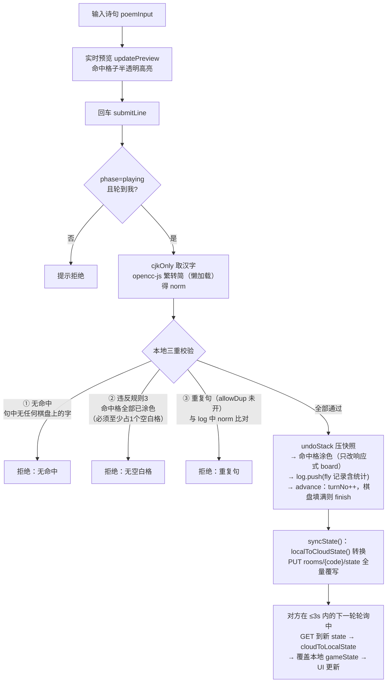
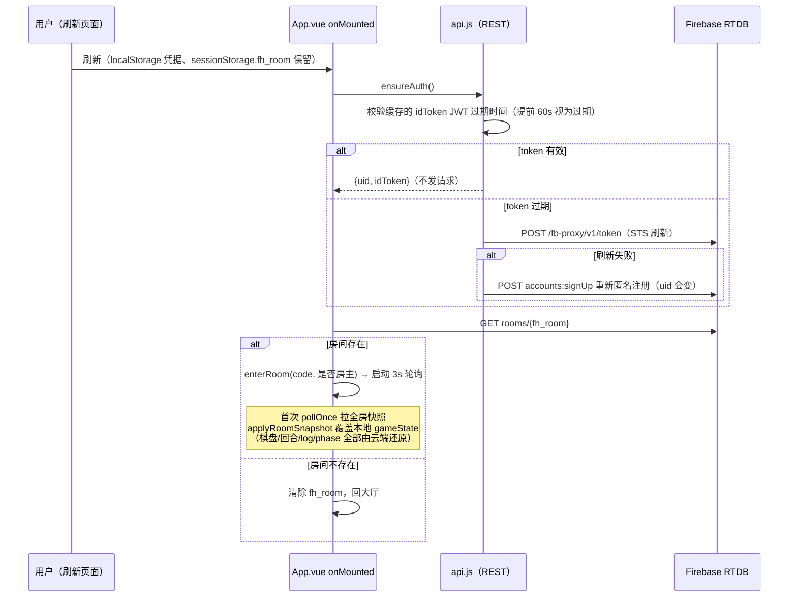

# 飞花斯普拉遁 · 架构梳理文档

> 目的：为「迁移到 WebSocket + Cloudflare Durable Objects」的重构提供现状基线。
> 版本基线：v2.4（App.vue 内标注），梳理日期 2026-10-23。
>
> **先说三个关键结论（重构前必读）：**
> 1. 前端**没有使用 Firebase JS SDK**，而是走「REST API + Pages Function 反向代理」的自研网络层（`src/api.js`），同步方式是 **3 秒轮询整房快照**。
> 2. 代码中**不存在 Challenge（对方裁决）机制**，云端也没有 `challenge` 节点；Worker 上已部署的 D1 诗句校验接口 `/api/poetry` **前端从未调用**——诗句合法性目前是纯本地判定。
> 3. 游戏状态的**权威源在客户端**：任何在席玩家都能整体覆写 `state`（安全规则只校验登录+在席，不校验回合合法性），这是迁移到 Durable Objects（服务端权威）的核心动机。

---

## 1. 文件目录与模块职责

```
feihuasplatoon-2/
├── index.html                 # Vite 入口 HTML（SPA 单页）
├── vite.config.js             # 本地 dev 把 /fb-proxy 转发到线上 Pages（本地无 Functions 环境）
├── wrangler.toml              # Cloudflare Worker 配置：feihua-poetry-api + D1 绑定 + 每日清理 Cron
├── database.rules.json        # Firebase RTDB 安全规则（rooms 子树的读写/校验规则）
├── poetry_init.sql            # D1 词库初始化 SQL（约 206MB，由脚本生成）
├── src/
│   ├── main.js                # Vue 应用入口，仅挂载 App
│   ├── App.vue                # 【巨石组件，约 1650 行】全部游戏逻辑 + 联机逻辑 + UI + 样式
│   ├── api.js                 # Firebase REST 网络层：匿名认证 + RTDB REST 封装（整个文件都是 Firebase 耦合）
│   ├── style.css              # 全局样式与 CSS 变量
│   ├── game/
│   │   ├── pools.js           # 纯数据：7 个基础字库（唐诗/宋词/苏轼/辛弃疾等各 300 高频字）+ 额外字池与频次权重
│   │   └── exporter.js        # 纯 Canvas 导出：PNG 战报截图 + 逐手回放 GIF（GIF89a/LZW 手写编码，零依赖）
│   └── assets/                # 静态资源（hero.png / vite.svg / vue.svg）
├── functions/
│   └── fb-proxy/[[path]].js   # Cloudflare Pages Function：/fb-proxy/* 反向代理到 Firebase（登录/续期/RTDB 三个上游域名）
├── worker/
│   └── index.js               # 独立 Worker：① GET /api/poetry D1 诗句精确校验 ② 每日 Cron 清理僵尸房间（服务账号 JWT → RTDB REST）
├── scripts/
│   └── import-poetry.js       # 语料清洗脚本：chinese-poetry 数据集 → 繁转简 → 切句 → 生成 poetry_init.sql
├── chinese-poetry/            # 上游语料库（github.com/chinese-poetry/chinese-poetry），仅作数据源
├── feihuasplatoon/            # 语料与历史数据的副本目录（无前端代码，勿混淆）
└── feihua-game/               # 空目录
```

### App.vue 内部逻辑分区（`<script setup>`，行号为当前文件位置）

| 区块 | 位置 | 职责 |
|---|---|---|
| Firebase 连接状态 | L7-22 | `fbStatus`（connecting/ok/lost/error）仅作 UI 指示 |
| 房间联机（轮询/心跳/踢出/接管） | L24-519 | 轮询同步、presence 心跳、席位顶替、房主转移、进退房（Firebase 耦合最重） |
| 常量与阵营名 | L521-547 | 赤/青默认名，双方可改名（写云端） |
| 全局游戏状态 `gameState` | L549-560 | 棋盘/回合/记录等核心状态（本地权威） |
| 设置与字库面板 | L562-668 | 棋盘尺寸、额外字、7 库勾选（poolMask 位运算）、派生量 |
| 工具函数 | L679-700 | `cjkOnly` 取汉字、`fmtPoem` 显示口径、opencc-js 懒加载繁转简 |
| 棋盘生成 | L702-712 | mulberry32 种子随机 + 洗牌 + 额外字加权抽取（双方同 seed 得同盘） |
| 导出 | L714-730 | 组装上下文交给 exporter.js |
| 输入与预览 | L732-797 | 诗句输入框、命中格子半透明预览、格子渲染 class 计算 |
| 修正模式/格子点击 | L799-825 | 手动循环切换格子归属（无主→赤→青） |
| 命中标记与记录渲染 | L827-879 | 从 log 重放得出每字的 new/cap/hold 类型 |
| **核心判定 `submitLine`** | L881-959 | 本地校验（命中/空白格/重复句）→ 涂色 → 记录 → 推进回合 → 全量同步 |
| 放弃/撤销/结算 | L961-1058 | passTurn、undoStack 撤销、棋盘填满或手动结算 |
| 设置项变更 | L1060-1138 | 尺寸/额外字变更→重铺棋盘→同步 |
| 输入框交互 | L1140-1167 | 回车提交、锁定提示 |
| 启动/卸载 | L1169-1199 | onMounted：匿名登录 + sessionStorage 房间恢复 + 注册 visibilitychange |

---

## 2. 核心数据结构 (State)

### 2.1 本地 `gameState`（App.vue L550，reactive）

| 字段 | 类型 | 说明 |
|---|---|---|
| `seed` | number | 随机种子。双方由同一 seed 确定性生成同一副棋盘（mulberry32 + 洗牌） |
| `side` | number | 棋盘边长 N（5–20），board 长度 = N×N |
| `board` | `[{ch, owner}]` | 格子数组：`ch` 格子上的字；`owner`：`null` 无主 / `'A'` 赤营 / `'B'` 青营 |
| `phase` | string | `'ready'` 待开局 / `'playing'` 对战中 / `'over'` 已结束 |
| `totalRounds` | number | 固定 0（「战至最后一刻」模式，保留字段兼容旧存档） |
| `endless` | boolean | 固定 true（同上） |
| `turnNo` | number | 1-based 总出手次数；奇偶决定当前阵营（奇=A 赤，偶=B 青） |
| `log` | array | 飞花/放弃记录。fly 项：`{type:'fly', team, round, line, norm, raw, hits, blank, capture, hold, cells}`；pass 项：`{type:'pass', team, round}` |
| `undoStack` | array | 撤销快照 `{board 副本, logLen, turnNo}`，提交/放弃前压入 |

**gameState 之外的关键本地状态：**

| 变量 | 说明 |
|---|---|
| `uid` | 当前匿名登录的 Firebase UID |
| `roomState` | `'lobby'` / `'playing'`，页面两级视图 |
| `roomCode` / `joinCode` | 当前房间码 / 输入框中的房间码 |
| `players` / `roomMeta` | 云端 `players`、`meta` 的本地镜像 |
| `myTeam`（computed） | 我在哪个阵营：本地 `'A'/'B'`，由 players 与 uid 比对得出 |
| `myTurn`（computed） | `myTeam !== null && currentTeam === myTeam` |
| `redOnline` / `blueOnline` | 对方席位在线标记（心跳 25 秒内为在线） |
| `peerKickable` | 对方离线满 3 分钟：徽标变「踢出」按钮 |
| `poolSel` | 7 个字库勾选状态 `{tang, song, songx, su, su2, xin, xin2}` |
| `recentRooms` | 最近加入的房间（localStorage `fh_recent_rooms`，最多 5 条） |
| `sessionStorage.fh_room` | 当前房间码——**断线重连的依据** |
| `localStorage.fh_idToken / fh_refreshToken / fh_uid` | 匿名认证凭据（api.js） |

### 2.2 云端 Firebase RTDB 结构

路径根：`https://feihuasplatoon-default-rtdb.asia-southeast1.firebasedatabase.app`，只有一棵子树 `rooms/`。

```
rooms/
└── {roomId}/                     # 6 位房间码（去掉易混淆字符的 32 进制字母表）
    ├── meta/
    │   ├── hostUid: string       # 房主 UID（房主身份跟人走，转移/接管由此字段决定）
    │   └── createdAt: number     # 建房时间戳（Worker Cron 清理的依据之一）
    ├── players/
    │   ├── red:  { uid, name }   # 赤营席位（本地 A）；name 默认「赤营」，可自定义 ≤12 字
    │   └── blue: { uid, name }   # 青营席位（本地 B）
    ├── state/                    # 整局游戏状态（客户端全量 PUT，见 2.3）
    │   ├── seed / side / totalRounds / endless / poolMask
    │   ├── board: [{ ch, owner: 'red'|'blue'|null }]
    │   ├── currentTurn: 'red'|'blue'
    │   ├── round / redScore / blueScore
    │   ├── history: [ fly/pass 记录 ]        # 本地 log 的云端形态（team 为 red/blue）
    │   ├── status: 'ready'|'playing'|'over'  # 本地 phase
    │   └── endReason: string|null
    └── presence/
        ├── red: number           # 赤营成员最后心跳时间戳（每 15s PUT 一次）
        └── blue: number          # 青营成员最后心跳时间戳
```

**没有 `challenge` 节点。** 当前版本不存在裁决流程（见第 3.3 节）。

**A/B ↔ red/blue 映射**（同步边界互转，App.vue L140-176）：
- `localToCloudState()`：本地 → 云端，owner/turn/log.team 全部做 A→red、B→blue 替换；poolMask 位合并
- `cloudToLocalState()`：云端 → 本地；并由 `round + currentTurn` 反推本地 `turnNo`：`turnNo = (round-1)*2 + (currentTurn==='blue' ? 2 : 1)`

### 2.3 `poolMask` 位标志（7 库开关，随 state 同步双方）

| bit | 值 | 字库 |
|---|---|---|
| 1 | tang | 全唐诗 300 |
| 2 | song | 全宋词 300 |
| 4 | su | 苏轼 300 |
| 8 | xin | 辛弃疾 300 |
| 16 | songx | 宋词 300（不含唐诗字） |
| 32 | su2 | 苏轼 301–600 |
| 64 | xin2 | 辛弃疾 301–600 |

### 2.4 Cloudflare D1 `poetry` 表（worker 侧，与 RTDB 无关）

```sql
CREATE TABLE poetry (id INTEGER PRIMARY KEY, sentence TEXT NOT NULL, author TEXT, title TEXT, dynasty TEXT);
CREATE INDEX idx_poetry_sentence ON poetry(sentence);
```
- 由 `scripts/import-poetry.js` 从 chinese-poetry 语料生成：繁转简、按非汉字字符切句、长度 4–30 过滤、同四元组去重
- Worker `GET /api/poetry?q=<纯汉字句>` 精确查询，同句多来源时优先返回信息最全的一条
- **现状：前端没有任何地方调用此接口**

### 2.5 RTDB 安全规则要点（database.rules.json）

| 路径 | 写权限 |
|---|---|
| `rooms/{id}` | 登录即可建（不存在时）；已存在仅房主可整房写/删 |
| `rooms/{id}/meta` | 房主可写；在席成员可在「房主席位空缺或离线>3 分钟」时改写 hostUid（接管） |
| `players/red|blue` | 本人可写自己席位；**顶替**仅当原占者离线>3 分钟；对方营成员也可移出离线>3 分钟的席位（踢出） |
| `state` | 仅在席成员（red/blue 任一 uid）可整写——**不校验回合合法性** |
| `presence/red|blue` | 仅对应席位本人可写 |
| 读权限 | 登录用户可读任意 6 位格式房间；meta 单独放宽到登录即可读（用于加入前判断存在性） |

---

## 3. 核心业务流程流转

### 3.1 创建 / 加入房间

```mermaid
flowchart TD
    A[页面加载 onMounted] --> B["api.ensureAuth()<br/>匿名注册/续期 Identity Toolkit<br/>得到 uid，写入 localStorage"]
    B --> C{sessionStorage<br/>有 fh_room?}
    C -- 有 --> D[GET rooms/{code}<br/>存在则直接 enterRoom 恢复]
    C -- 无 --> E[大厅]

    E -- 创建房间 --> F["循环 5 次：genCode() 生成 6 位码<br/>GET rooms/{code} 确认不存在"]
    F --> G["重铺棋盘（seed）+ 初始化本地 state<br/>PUT rooms/{code} 整房写入<br/>meta+players(red=我)+state"]
    G --> H["enterRoom：roomState=playing<br/>sessionStorage 记码<br/>启动轮询 startPolling"]

    E -- 加入房间 --> I[GET rooms/{code}/meta 判断存在性]
    I -- 不存在 --> J[提示并从最近列表移除]
    I -- 存在 --> K[GET players：我的 uid 已在席位?]
    K -- 是（重连/换设备） --> H
    K -- 否 --> L["选席策略：<br/>① 空席优先（两席全空→青营）<br/>② 被占席仅当占者离线>3min 可顶替<br/>③ 双方可顶替时选离线更久者"]
    L -- 无席可用 --> M[提示房间已满]
    L -- 选定 target --> N["PATCH players/{target}={uid,name}<br/>（安全规则做顶替时限校验）"]
    N --> H
```

进入房间后，同步由 **3 秒轮询**驱动（详见 4.1）：每轮 `GET rooms/{code}` 全量拉取 → 写心跳 → 判在线 → 房间维护（接管无主房）→ JSON 比对有变化才 `applyRoomSnapshot` 覆盖本地。

### 3.2 提交诗句与同步（submitLine，App.vue L882-959）

> 注意：**此链路中没有「查词库」步骤**。诗句是否真实存在不做验证，只验证「是否命中棋盘」。



关键点：
- **涂色是纯客户端计算**：命中 = 句中每个字在 board 上对应的所有格子（同字多格全中），格子从空白/对方手中变为己方（新占/抢夺/己方三类统计）。
- **同步是「全量 PUT」**：棋盘 100–400 格 + 全部历史记录每次整体覆写，无增量。
- **撤销/放弃/修正模式/再来一局/改设置** 走同一条 `syncState()` 全量覆写路径。
- **冲突模型是「最后写入赢」**：双方几乎同时提交时（受回合锁约束理论上不会），后写者覆盖前者。服务端无任何校验。

### 3.3 对方裁决 (Challenge) —— **当前不存在**

用户预期中的「查库失败 → 云端 challenge 节点 → 双方弹窗裁决」流程，**在当前代码中完全没有实现**：

- 全代码库（src/、functions/、worker/、rules）中无 `challenge` 字样；
- 云端 rooms 树只有 `meta / players / state / presence` 四个节点；
- 提交被拒的三种情况（无命中 / 无空白格 / 重复句）都是**本地同步判定**，无网络往返、无对方参与、无弹窗裁决；
- Worker 的 `/api/poetry`（D1 诗句精确校验）已部署但**前端未接入**——「查词库」在当前版本不是提交链路的一环。

推断：这可能是早期版本/计划中的功能。**迁移到 Durable Objects 时若要补全此功能**，建议落点：DO 内做权威校验（调用 D1 或内置词库）→ 校验失败广播 `challenge` 事件给双方 → 双方投票/超时自动判 → 结果写入权威状态。届时 DO 是天然的裁决方，不需要 RTDB 时代的「云端节点 + 轮询发现」模式。

### 3.4 断线重连



补充：
- 若匿名注册被降级为「重新 signUp」（uid 变化），重连后 `myTeam` 比对不上 → 作为新人走加入流程（可能顶替自己留下的旧席位，旧席位心跳已停）。
- 轮询中发现 `GET` 报 `permission denied / 401 / 403` → 判定被踢（安全规则因对方移除席位而拒读）→ `exitRoom('kicked')` 回大厅。
- 轮询中发现 `rooms/{code}` 变为 null → 房主已解散 → `exitRoom('dismissed')`。
- 页面隐藏（`visibilitychange`）暂停轮询定时器，恢复可见立即拉一次并重启。

---

## 4. 网络层现状与「技术债」

### 4.1 当前通信机制全貌

```
浏览器 ──fetch──▶ /fb-proxy/*（同源 Pages Function）
                    ├── /v1/accounts:signUp ──▶ identitytoolkit.googleapis.com   （匿名注册）
                    ├── /v1/token           ──▶ securetoken.googleapis.com       （STS 刷新令牌）
                    └── rooms/*.json?auth=idToken ──▶ RTDB asia-southeast1 实例  （数据读写）

Worker（feihua-poetry-api，独立部署）
    ├── GET /api/poetry?q=  ──▶ D1（前端未调用）
    └── Cron 0 3 * * *      ──▶ 服务账号 JWT → OAuth2 → RTDB REST shallow 扫 rooms → 删 24h 死房
```

**轮询循环细节（App.vue L178-266）：**

| 机制 | 参数 | 说明 |
|---|---|---|
| 全房拉取 | 每 **3s** `GET rooms/{code}` | 含 meta+players+state+presence 全量 |
| 变更检测 | `JSON.stringify([meta,players,state])` 与上次比对 | presence 不参与比对（避免心跳触发界面刷新） |
| 心跳写入 | 每 **15s** `PUT presence/{seat}=Date.now()` | REST 无 onDisconnect，只能时间戳判在线；用 PUT 而非 PATCH（RTDB REST 的 PATCH 不接受裸数字） |
| 离线判定 | 心跳 **25s** 内为在线 | 15s 心跳 + 3s 轮询的抖动余量 |
| 踢出/顶替阈值 | 离线 **3min**（180000ms） | 前端、安全规则、接管逻辑三处硬编码一致 |
| 房间维护 | 每 30s 最多一次 | 无主/房主离线 3min → 在席成员 PATCH meta.hostUid 接管 |
| 页面隐藏 | 停定时器；恢复立即拉一次 | 省额度 |
| 容错 | 401 自动续期重试一次；响应是 HTML（Cloudflare 回退 SPA index.html）时重试一次再抛可读错误 | api.js 内 |

### 4.2 与 Firebase 深度耦合、迁移 DO 时必须删掉重写的部分

#### ① 整个 `src/api.js`（约 140 行，100% Firebase 专属）
- Identity Toolkit 匿名注册（`accounts:signUp`）、STS 令牌刷新（`securetoken /v1/token`）
- idToken/refreshToken/uid 的 localStorage 管理与 JWT 过期解析
- `authedRequest`（`?auth=idToken` 查询参数鉴权、401 重试）、`rtdbGet/rtdbSet/rtdbPatch/rtdbRemove` 四个导出
- **替代**：DO WebSocket 连接即身份（连接时带房间码+临时身份令牌即可），不再需要匿名账号体系与令牌续期

#### ② 整个 `functions/fb-proxy/` 目录
- 纯粹为绕过 Firebase 跨域/workers.dev 阻断而存在，迁 DO 后无任何意义，直接删除

#### ③ `database.rules.json` 整个文件
- RTDB 规则模型不复存在。但其中沉淀的**业务规则必须在 DO 中重写为服务端逻辑**：
  - 席位顶替的「离线>3 分钟」判定
  - 房主接管条件
  - 踢出操作权限
  - presence 写权限（→ DO 的 WebSocket 连接/断开事件天然替代心跳）

#### ④ App.vue 中所有联机相关代码（重构主战场，约 500 行）

| 函数/状态 | 行号 | 迁移去向 |
|---|---|---|
| `fbStatus / connText / lobbyStatusText` | L7-22 | 改为 WebSocket 连接状态 |
| `uid / myTeam`（基于 Firebase UID 比对） | L10-44 | 改为 DO 分配的连接身份 |
| `pollOnce / startPollTimer / stopPollTimer / startPolling / stopPolling / onVisibilityChange` | L183-266 | **整体删除**，替换为 WS 消息推送（onmessage 分发） |
| `lastRoomJson / lastBeatAt`（比对缓存、心跳计时） | L179-181 | 删除（WS 是推送，无需比对；在线状态由连接断开判定） |
| 心跳/在线判定/`peerKickable` 计算 | L204-227 | DO 侧用连接存活性实现，推 `peer_offline/peer_kickable` 事件 |
| `maintainRoom`（房主接管） | L296-322 | DO 服务端逻辑（host 掉线自动转移或房间销毁，根本不需要「接管」补丁） |
| `applyRoomSnapshot / cloudToLocalState / localToCloudState` | L140-176, L267-284 | 改为 WS 增量事件（`move_applied`、`phase_changed` 等），A/B↔red/blue 映射层可整体消失（统一一种命名） |
| `syncState`（全量 PUT state） | L287-292 | 改为 `send({type:'submit'|'pass'|...})`，权威状态在 DO |
| `createRoom / joinRoom / exitRoom / kickPeer / switchSide / saveTeamName` | L59-70, L325-519 | 改为 WS 信令消息（create/join/leave/kick/rename），房间生命周期由 DO 管 |
| onMounted 中的 `ensureAuth` + sessionStorage 恢复 | L1170-1192 | 改为 WS 重连握手（携带房间码，DO 内存态直接恢复） |

#### ⑤ `worker/index.js` 的清理逻辑（保留文件、删除 Firebase 部分）
- `scheduled` / `cleanupRooms` / `getAccessToken` / 服务账号 JWT（L45-151）：专为清理 RTDB 死房而生，**删除**。DO 天然有生命周期（`alarm()` 可做房间过期自毁）
- `GET /api/poetry`（D1 查询，L17-43）：**保留**，且建议在 DO 权威校验流程中真正用起来（见 3.3）

#### ⑥ 隐性依赖（容易漏）
- `vite.config.js` 的 `/fb-proxy` dev 代理：删除
- `wrangler.toml`：需改造（加 Durable Objects binding，Cron 触发器可去）
- localStorage 的 `fh_recent_rooms`（最近房间列表）是纯本地功能，可保留，但其中 `host` 标记语义要跟新身份体系对齐
- 提交失败的本地三重校验（无命中/无空白格/重复句）目前在前端；迁 DO 后应**原样搬到 DO 服务端**作为权威判定，前端保留一份做即时预检

### 4.3 可以原样保留（与 Firebase 无关）的部分

| 部分 | 说明 |
|---|---|
| `gameState` 核心玩法逻辑 | 涂色计算、回合奇偶、分数统计、结算/撤销——迁 DO 时作为「服务端权威规则」的实现参考 |
| `buildBoard / mulberry32 / seededShuffle / seededPickExtras`（pools.js + App.vue） | seed 可复现棋盘生成。迁 DO 后可整体挪到 DO 内（服务端定 seed，客户端只收棋盘或自行由 seed 重建） |
| `pools.js` | 纯静态数据 |
| `exporter.js` | 纯本地 Canvas 导出，只要给它同样的 game 上下文 |
| opencc-js 繁转简 | 保留（DO 端校验时同样需要统一简体口径） |
| `scripts/import-poetry.js` + D1 词库 | 与 RTDB 无关，照常使用 |

### 4.4 现有架构的问题清单（重构收益点）

1. **延迟与额度**：3s 轮询全房快照（棋盘 400 格 + 全部 log），一方操作后对方平均 1.5s、最坏 3s 才看到；每次都是全量 JSON，Function 调用额度消耗大。→ WS 推送增量事件，延迟降到毫秒级。
2. **无服务端权威**：`state` 任何在席玩家可整写、不校验回合，理论上可作弊（改棋盘/跳回合/直接改分数）；双方同时写靠「最后写入赢」兜底。→ DO 作为唯一权威源，客户端只发意图。
3. **在线判定靠心跳时间戳**：REST 无 onDisconnect，只能 15s 心跳 + 25s 阈值近似；断网后对方要等 25s 才显示离线。→ WS 连接断开事件即时感知。
4. **踢出/顶替/接管逻辑散落三处**（前端阈值、RTDB 规则、Worker Cron），阈值 180000ms 硬编码一致才能工作。→ 全部收敛进 DO。
5. **全量覆写的带宽浪费**：每手 PUT 整个 state（含全量 history，log 越长越大）。→ 增量消息。
6. **房间清理靠每日 Cron 扫描 RTDB**。→ DO `alarm()` 精确过期。
7. **App.vue 巨石组件**（约 1650 行，UI+逻辑+联机混杂）：重构时顺势拆分——`useGameRoom()`（WS 连接管理）、`useBoard()`（棋盘/判定）、UI 组件（大厅/棋盘/记录/结算）。
8. **查词库能力闲置**：D1 词库 + `/api/poetry` 已就绪但未接入任何流程；DO 权威校验是接入的天然时机（见 3.3 的 challenge 建议）。

---

## 重构影响评估（DO + D1 迁移）

> 评估基线：本文件第 1–4 章的现状结论 + 全量代码复核（App.vue 1652 行 / api.js 140 行 / worker/index.js 151 行 / database.rules.json 152 行 / fb-proxy 53 行），评估日期 2026-10-23。
> 对照蓝图：① 弃 fetch/轮询 ② WSS 全双工 ③ DO 权威状态机 ④ 前端保留 gameState、消息携带状态变更、收到即覆盖。

### 0. 动手前必须拍板的三件事（蓝图与现状的冲突）

**① 蓝图第 3 条与第 4 条互相矛盾。**
第 3 条说「DO 是唯一权威，验证后广播」；第 4 条说「前端把整份状态变更封装进消息，收到直接覆盖」。如果消息里携带的是**整份状态**，DO 就退化成转发器——权威仍在客户端，今天「任何在席玩家可整写 state」的作弊面原样保留，只是换了传输。两者只能选一：

- **方案 A（真权威，推荐）**：客户端只发**意图**（`submit{raw,norm}` / `pass` / `fix_cell{idx}` …），DO 执行三重校验+涂色+推进回合，广播**全量快照**；前端收到快照直接覆盖本地 gameState——蓝图第 4 条「收到即覆盖」的体验目标仍达成，只是发送侧从「推状态」改为「发意图」。
- **方案 B（纯转发）**：前端改动最小，但 DO 白建，权威问题（作弊/冲突覆盖/回退）一个都没解决。

本评估其余部分按**方案 A** 展开；若选 B，工作量按更低档裁剪。

**② D1 不适合当「每手都写」的热状态存储。**
推荐：房间热状态放 **DO 内存 + `ctx.storage`**（同实例事务性 KV，hibernation 后可恢复），D1 只保留两个职责：词库校验（DO 内直调 `env.DB` 替代 HTTP 自调 `/api/poetry`）+ 可选终局归档。坚持每手写 D1 在休闲量级下也跑得动（免费额度 10 万行写入/天足够），但大 JSON 行 UPDATE、嵌套结构拍平建模、广播等待或 fire-and-forget 的取舍全是纯负收益（详见第 4 节雷 2 对照表）。

**③ 身份体系整体蒸发，必须重新发明（工作量最被低估的一项）。**
今天所有权限（席位、房主、踢出、顶替、接管）都锚在 Firebase `uid` 上；api.js 删除后项目里**不存在任何身份**。DO 方案需要新建：localStorage 持久化的 `clientId`（`crypto.randomUUID()`）+ DO 签发的 `seatToken`；重连握手 = WS 连接携带 `{code, clientId, seatToken}`，DO 比对后决定「resume」还是「当新人走加入流程」。这不是删除，是约 100 行新代码 + 一套新的边界情况（见 3-B-6 双开问题）。

### 1. 彻底废弃并删除的部分 (The Graveyard)

| 目标 | 行数 | 备注 |
|---|---|---|
| `src/api.js` 整个文件 | **140** | 匿名注册 / STS 续期 / JWT 解析 / 401 重试 / RTDB 四个 REST 封装，100% Firebase 专属 |
| `functions/fb-proxy/[[path]].js` 整个目录 | **53** | 代理三上游域名，DO 后无意义 |
| `database.rules.json` 整个文件 | **152** | 规则表达式作废；其中业务约束迁 DO 重写（见 3-B-3） |
| `worker/index.js` L45-151 | **~107** | `scheduled` / `cleanupRooms` / `getAccessToken` / 服务账号 JWT 全家；L1-43 的 `/api/poetry` 保留（DO 内改 `env.DB` 直调） |
| `vite.config.js` 的 `/fb-proxy` 代理块 | **8** | 换成 `/ws` 代理（见雷 5） |
| App.vue 直接删除段 | **~200** | 明细见下表 |
| **纯删除合计** | **≈ 660 行** | 另有 App.vue 内 ~200 行「功能保留、实现重写」不计入（见第 2 节） |

App.vue 直接删除明细：

| 段 | 行号 | 行数 |
|---|---|---|
| `fbStatus` / `connText` / `lobbyStatusText` 三态指示 | L7-22 | 16 |
| A/B↔red/blue 映射 `localToCloudState` / `cloudToLocalState` | L139-176 | 38（统一命名后整体消失） |
| 轮询全家 `pollOnce` / `startPollTimer` / `stopPollTimer` / `startPolling` / `stopPolling` + `lastRoomJson` / `lastBeatAt` JSON 比对 + 心跳写入 | L178-266 | ~89（`onVisibilityChange` 的可见性感知保留改造） |
| `applyRoomSnapshot` | L267-284 | 18（被 onmessage 快照覆盖取代） |
| `syncState` 全量 PUT | L287-292 | 6 |
| `maintainRoom` 接管轮询逻辑 | L294-322 | 29（「接管」概念整体消失，见 3-B-3） |
| `uid` ref 及散布的 uid 比对分支 | — | ~10 |

**App.vue 总触达 ≈ 400 行（约 24%）**：~200 行删除 + ~200 行重写。

### 2. 需要完全重写的部分 (The Rewrites)

#### 2.1 发送方向：`syncState()` 的 7 类调用点 → 13 种 intent 消息

今天所有变更共用一条「本地改完 → `localToCloudState()` → PUT 全量 state」路径（调用点：submitLine / passTurn / undo / again / startGame / onSizeChange / onExtraChange / onRedraw / onFinish / togglePool / selectAllPools / onCellClick / saveTeamName / createRoom / joinRoom / exitRoom / kickPeer / switchSide / maintainRoom）。WS 化后每类变成独立消息：

| 今天的调用 | 新消息（客户端→DO） | DO 侧校验 / 动作 |
|---|---|---|
| createRoom（GET 探重名 ×5 + PUT 整房） | `create` | `idFromName(code)` 确定路由，DO 内判存在 → 建 meta / 定 seed / 铺棋盘；GET 探重名模式作废（雷 7） |
| joinRoom（GET meta→players→presence→PATCH 席位） | `join{code}` | resume（clientId 命中席位）或走选席策略（空席优先 / 离线>3min 顶替，规则原样搬入 DO） |
| submitLine | `submit{raw, norm}` | DO 重跑三重校验+涂色+log+advance（校验代码从 App.vue L895-956 平移） |
| passTurn | `pass` | 回合锁硬校验 |
| undo | `undo` | undoStack 建议整体搬进 DO；校验「栈顶是我这手」才放行（今天谁都能 undo 覆盖对方，见 3-C） |
| onCellClick（修正模式） | `fix_cell{idx}` | DO 循环 无主→赤→青；串行化，双方同点不再互相覆盖 |
| saveTeamName | `rename{name}` | ≤12 字校验 |
| togglePool / selectAllPools / onSizeChange / onExtraChange / onRedraw | `set_pool{mask}` / `redraw` / `set_size{n}` / `set_extra{k}` | 仅 phase=ready；是否限房主需拍板（3-C） |
| startGame / again / onFinish | `start` / `again` / `finish` | — |
| kickPeer / switchSide / exitRoom | `kick` / `switch_side` / `leave` | leave 触发席位释放；房主 leave = 解散广播 |

#### 2.2 接收方向：轮询+JSON-diff → 单一 `onmessage`

- 删除「3s 定时器 + `JSON.stringify` 比对 + presence 不参与比对」整套机制；WS 推送天然只在变化时到达。
- 下行只有两类消息：**`snapshot`**（meta+players+state 全量，前端简化版 `cloudToLocalState` 直接覆盖 gameState）与**事件**（`kicked` / `dismissed` / `peer_offline` / `peer_kickable` / `evicted` / `error`）。
- `redOnline` / `blueOnline` / `peerKickable` / `peerOffline` / `gotRoomSnapshot` 五个响应式量**保留**，数据来源从「心跳时间戳计算」变为「DO 事件」——UI 层零改动，本次迁移少有的免费午餐。
- **必须新增**：重连指数退避、连接状态机（对应今天 fbStatus 三态但语义变）、页面隐藏保活策略（WS 不像轮询可随便停，见雷 6）。

#### 2.3 DO 服务端（全新，约 350-450 行）

- entry worker 按 `idFromName(roomCode)` 路由 WS 升级请求到对应 DO；accept + hibernation 注册；
- 状态装载/落盘：**hibernation 会清内存**——每次变更后 `ctx.storage.put('room', snapshot)`，唤醒时 load。不做这一步，房间静置几分钟状态就没了（这是蓝图没提的隐藏工作量）；
- intent 分发器 + 权限 / 回合锁 / 三重校验 / 选席策略；
- 广播 + `setWebSocketAutoResponse`（协议层 ping/pong 保活，不唤醒 DO 不计费）+ `alarm()`（房间 24h 过期自毁，替代每日 Cron）；
- D1 调用：提交时 `env.DB` 查词库（challenge 前置校验）。

客户端 WS 层约 150-200 行（连接管理 + send 封装 + onmessage 分发）。
**总账：删 ≈660 行，新写 ≈500-650 行；行数大致打平，但复杂度形态改变（服务端权威 + 新增身份体系）。**

### 3. 需要仔细保留与迁移的部分 (The Delicate Parts)

#### A. 可原样搬走（复用，零改写）

| 代码 | 去向 |
|---|---|
| `mulberry32` / `seededShuffle` / `seededPickExtras` / `buildBoard`（App.vue L82-137） | 平移进 DO（服务端定 seed）；前端可留一份做本地预铺 |
| `pools.js`（字库+权重，纯数据） | DO import + 前端 import（预览仍需要） |
| `submitLine` 校验+涂色+统计核心（L895-956 纯计算部分） | 平移进 DO；前端保留 `updatePreview` 即时预览 |
| `hitKinds` / `cellsOf` / `poemSegs`（记录重放渲染，L827-878） | 原样保留（依赖全量 log，快照里有） |
| `exporter.js`（PNG/GIF 导出，零依赖） | 原样保留 |
| opencc-js 懒加载（L692-699） | 仅前端保留；**DO 打包不了**（雷 3） |
| `undoStack` 快照结构 | 数据结构不变，换宿主进 DO |
| `gameState` 结构 / `recentRooms` / `fmtPoem` / 修正模式循环序 | 原样保留 |

#### B. 逻辑保留、实现必须换（按迁移难度排序）

1. **断线重连（改动最大）**：删 onMounted 中 `ensureAuth` + `GET rooms/{fh_room}` 恢复（L1169-1188，约 20 行）；新流程 = 启动即连 WS 携带 `{code?, clientId}` → DO 回 `resume`（快照直接进房，sessionStorage.fh_room 逻辑保留）或 `not_found`。**注意**：sessionStorage 只救「同标签刷新」；换标签/重开浏览器这条路径今天是靠 localStorage 里的 Firebase uid 兜底的，现在必须靠新发明的 clientId + recentRooms 显式设计，约 40-60 行新代码。
2. **在线判定**：15s PUT 心跳 + 25s 阈值 → DO 侧连接存活 + pong 时间戳。**移动端页面冻结不触发 WS close**（微信内置浏览器 / iOS Safari 后台），所以「离线满 3 分钟可踢/可顶替」的计时基准必须用 **pong 超时**而非 close 事件，否则对方真离线后永远等不到可踢。`peerOffline` 横幅「对方离线仍可正常提交」的语义保留（DO 不要求对方在线）。
3. **踢出/顶替/接管**：rules 里三坨巨型表达式（rules L9 meta、L21/L32 players）→ DO 处理器内的 if 判断，逻辑等价搬运。「接管」整个消失：DO 是权威，房主掉线由 DO 自己处理（转移或等待），不再需要「在线成员自我提拔」的补丁。
4. **回合锁**：今天是纯客户端自觉（`myTurn` computed + 提交入口判断），RTDB 不校验；DO 化后是服务端硬校验，顺带消除 turnNo 奇偶脱同步的隐患。
5. **allowDup 未同步问题（现状坑，必须借迁移修掉）**：`allowDup` 是本地 ref，不进 `localToCloudState`——今天 A 开了允许重复句、B 没开，两边查重规则不一致且互相不知情。查重搬到 DO 后 `allowDup` **必须**变成同步设置（进 snapshot）；`keepPunct` 是纯显示口径，可继续本地。
6. **双开/多标签（全新边界，蓝图未提）**：今天同一 uid 开两个标签各自轮询心跳，勉强能跑；WS 化后两个连接抢同一席位必须定义行为——建议「新连接 evict 旧连接」（DO 给旧连接发 `evicted` 事件，旧标签回大厅）。

#### C. 顺带修掉的现存缺陷（DO 化的隐性收益，也是行为变化点）

- **undo 覆盖对方**：今天 A 提交后 B 紧接着提交，A 再点撤销会把 B 这一手整个回滚（undoStack 快照 + 全量 PUT，last-write-wins）。DO 校验「栈顶是我这手」后此 bug 消失，但**撤销从此可能被服务端拒绝**，前端要有对应提示。
- **设置无房主限制**：`onRedraw` / `onSizeChange` / `togglePool` / `startGame` 今天只挡 phase 不挡身份（RTDB 规则会拒掉非在席者，但报错体验差）。DO 化时需拍板：维持「在席人人可改」还是收敛为房主。
- **修正模式并发**：双方同时开修正模式点同一格，今天后写覆盖先写；DO 串行化后自然修复。

### 4. 隐藏的雷区与待确认事项

**雷 1｜蓝图矛盾（最高优先级）**：见第 0-① 节。不定方案 A/B，DO 消息协议没法落笔，先拍板再动代码。

**雷 2｜数据形状对照：Firebase 好存 vs D1 难存**：

| 数据 | RTDB（今天） | D1（关系型） | 结论 |
|---|---|---|---|
| `board` 100-400 格数组 | 原生树 | 400 行 cells 表 vs 一列 JSON TEXT | JSON TEXT 务实；归一化表纯增写放大 |
| `history` 追加式数组 | 原生 append | history 表（append-only，其实最合关系型） | 可表化；但为重放一致性建议随快照整存 |
| `players {red:{},blue:{}}` | 原生嵌套 | 两列或两行 | 小事 |
| `poolMask` 位标志 | 数字 | INTEGER | 无差异 |
| presence 时间戳 | 原生 | — | **整个消失**（WS 存活替代） |
| 「扫全表找死房」（Cron shallow 逐房 GET） | 只能 shallow 扫 | `SELECT ... WHERE last_active < ?` 一条 SQL | **D1 反而更容易**——若终局归档进 D1，清理问题顺带解决 |
| 热状态每手写 | 全量 PUT | 每手 UPDATE 大行 + 跨网络往返 | **别用 D1 存热状态**，用 `ctx.storage` |

**雷 3｜norm 只能信任客户端**：DO 打包不了 opencc（worker/index.js L5 注释已验证词库顶爆免费版包体限制），DO 侧查重/涂色/challenge 全部基于客户端送来的 `norm`。恶意客户端可送改过的 norm 绕过查重。休闲对局建议接受并记录在案；要堵只能 DO 内置简繁映射子集（工程量大，不建议）。

**雷 4｜免费计划的 DO 只支持 SQLite-backed**：`[[migrations]]` 必须写 `new_sqlite_classes`（KV 版 `new_classes` 是付费计划专属），且 hibernation 才免时长计费——配置错一项 `wrangler dev` 直接起不来。

**雷 5｜本地 dev 双进程接线**：vite(5173) + `wrangler dev`(8787)，`vite.config.js` 需把 `/ws` 代理到 `ws://127.0.0.1:8787` 且开 `ws: true`。生产部署需选型：Pages(静态) + 独立 DO Worker 双部署 vs 单 Worker（Static Assets）一把梭——**推荐后者**，少一套绑定与跨域心智。

**雷 6｜WS「假在线」**：移动端后台冻结不发 close、不收消息。DO 必须配 `setWebSocketAutoResponse`（协议层 ping/pong）+ 客户端应用层 15-25s ping 兜底，离线判定一律以 pong 时间戳为准。

**雷 7｜房间存在性检查模式反转**：今天 createRoom 先 `GET rooms/{code}` ×5 次探重名、joinRoom 先 `GET meta` 判存在；DO 世界 `idFromName(code)` 路由确定，**存在性只能连上 DO 问**（`create` → DO 回「已存在请重试」；`join` → DO 回 not_found / resume / 选席结果）。流程反而简化，但别照抄旧流程改一半。

**雷 8｜log 无限增长**：快照广播含全量 history，长局几百手后每条快照几十 KB（今天全量 PUT 已然如此，非新增问题）。建议 v1 全量快照跑通，之后有需要再做增量。

**雷 9｜`fbStatus` UI 语义**：三态文案含「已连接 Firebase」等硬编码 6 处（script 2 处 + template 1 处 + computed 2 处），改造时别漏 template 的 `:class="fbStatus"`。

**第一步最容易卡住的地方（直答）**：

1. **wrangler.toml 的 DO migration + 本地双进程**（雷 4 + 雷 5）——第一天大概率耗在这里。建议先跑通一个 hello-world DO（WS echo）再动业务。
2. **雷 1 的权威模型拍板**——协议不先定，代码全是返工。建议顺序：先定消息协议文档（13 种 intent + snapshot 结构）→ 搭 DO 骨架 → 最后动 App.vue。
