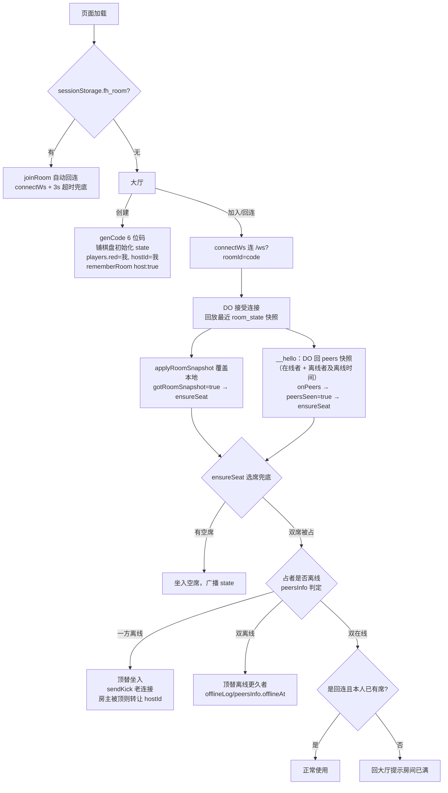
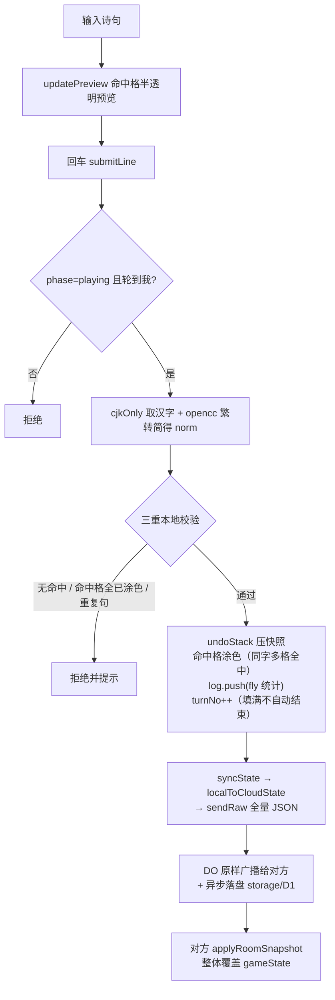
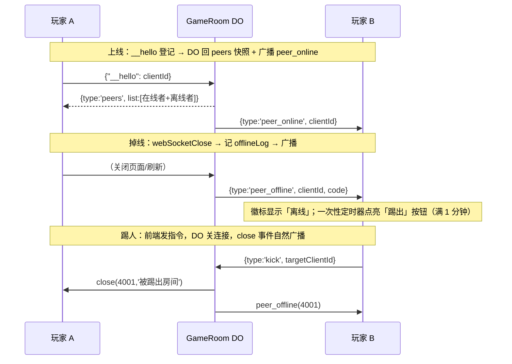

# 飞花斯普拉遁 · 架构梳理文档

> 版本基线：v3.1（App.vue 内标注），梳理日期 2026-10-23。
> 技术形态：Vue 3 + Vite 前端 / Cloudflare Worker + GameRoom Durable Object 实时层 / D1 持久化。
> Firebase 已彻底移除（api.js、fb-proxy、database.rules.json 均已删除）。

**三个关键结论（先读）：**

1. **实时层是「方案 B 纯转发」**：DO 不解析业务，前端把整份 `gameState` 序列化成 JSON 字符串发出，DO 原样广播给对方并异步落盘（DO storage + D1）。权威状态仍在客户端（最后写入赢），DO 只负责连接管理、在线事件、踢人指令与持久化。
2. **100% 事件驱动，无任何轮询**：无心跳定时器、无在线查询定时器。在线状态由 DO 的 `__hello` / `webSocketClose` 事件推送；断网假死靠 `visibilitychange` / `online` 事件兜底重连。
3. **身份体系 = localStorage 随机 `clientId`**：无账号体系。席位归属、房主转让、在线徽标全部以 `clientId` 比对。刷新/换标签后 `clientId` 不变，`sessionStorage.fh_room` 记住房间码实现自动回连。

---

## 1. 文件目录与模块职责

```
feihuasplatoon-2/
├── index.html                  # Vite 入口（SPA 单页，title 未改仍叫 feihua-game）
├── vite.config.js              # dev 代理：/ws → ws://127.0.0.1:8787（wrangler dev），ws:true
├── wrangler.toml               # Worker 配置：feihua-realtime + DO(GameRoom, SQLite 后端) + D1 + [assets] ./dist
├── poetry_init.sql             # D1 词库初始化 SQL（约 206MB，import-poetry.js 产物，已导入）
├── ARCHITECTURE.md             # 本文档
├── src/
│   ├── main.js                 # Vue 应用入口，仅挂载 App
│   ├── App.vue                 # 【巨石组件，约 1606 行】全部游戏逻辑 + 联机逻辑 + UI + 样式
│   ├── useWebSocket.js         # WS 实时层（142 行）：连接管理/重连/兜底事件/收发封装，与 DO 协议一一对应
│   ├── style.css               # 全局样式与 CSS 变量
│   ├── game/
│   │   ├── pools.js            # 纯数据：9 个基础字库字符串（唐诗/宋词/苏辛词各三档）+ 额外字池与频次权重
│   │   └── exporter.js         # 纯 Canvas 导出：PNG 战报截图 + 逐手回放 GIF（GIF89a/LZW 手写编码，零依赖）
│   └── assets/                 # hero.png / vite.svg / vue.svg
├── functions/
│   └── ws.js                   # Pages Function：/ws 反向代理 → 线上 Worker（Pages 部署的网页用它连 DO）
├── worker/
│   └── index.js                # 独立 Worker（wrangler deploy 部署）：GameRoom DO + /ws 入口路由
├── scripts/
│   ├── import-poetry.js        # 语料清洗：chinese-poetry → 繁转简 → 切句(4-30字) → poetry_init.sql
│   └── rebuild-su-xin-pools.js # 苏辛词字频重筛：只统计正文 paragraphs，输出三档各 200 高频字
├── chinese-poetry/             # 上游语料库（数据源，保留）
├── public/                     # favicon.svg / icons.svg
└── dist/                       # 构建产物（npm run build 生成；wrangler.toml [assets] 也指向它）
```

**部署目标（两个，分开部署）：**

| 目标 | 内容 | 命令 |
|---|---|---|
| Cloudflare Pages（github 自动） | 静态前端 + functions/ws.js 代理 | git push 即部署 |
| Worker feihua-realtime | DO + 入口路由 | `npx wrangler deploy`（**协议变更必须手动重新部署**） |

### App.vue 内部逻辑分区（`<script setup>`，行号为当前文件位置）

| 区块 | 位置 | 职责 |
|---|---|---|
| 连接状态与身份 | L15-50 | `uid`（localStorage clientId）、`connText`/`fbStatus` 三态指示 |
| 席位与在线状态 | L53-140 | `players`/`myTeam`、`redOnline`/`blueOnline`/`peerKickable`、`peersInfo` 缓存、`kickPeer` 踢人 |
| 棋盘生成 | L149-159 | `buildBoard(seed)`：mulberry32 + 洗牌 + 额外字加权（双方同 seed 同盘） |
| 云端快照转换 | L161-206 | `localToCloudState` / `cloudToLocalState`：A↔red、B↔blue 映射 + meta/players 一体序列化 |
| 快照应用与同步 | L208-251 | `applyRoomSnapshot`（覆盖本地 + `ensureSeat()` 兜底）、`syncState()`（全量广播） |
| 在线事件 | L253-301 | `onPeers` 快照 / `onPeerOnline` / `onPeerOffline`（只更新徽标不弹提示）、`refreshOnline` |
| 席位兜底与切营 | L307-400 | `ensureSeat`（无席随时补坐/顶替离线者）、`pickTeam`（点击阵营标签换席） |
| 进退房 | L402-553 | `onWsRejected`、`exitRoom`（房主转让）、`joinRoom`（3s 超时兜底）、`createRoom`、`rejoin` |
| 阵营名与字库设置 | L554-648 | `saveTeamName`、`gameState` 定义、`POOL_OPTIONS`（9 项）、`togglePool` |
| 派生量 | L650-700 | `score`、`phaseText`、`startLabel`/`redrawLabel`、`activePoolSet`、消息条（5s 自动消失） |
| 工具函数 | L713-800 | `cjkOnly`、`fmtPoem`、opencc-js 懒加载繁转简 |
| 输入与预览 | L800-1000 | 诗句输入、命中格子半透明预览、修正模式 `onCellClick`、`submitLine` 核心判定 |
| 撤销/放弃/结算 | L1000-1136 | `passTurn`、`undo`（undoStack）、`again`/`redrawOrAgain`、`startGame`、`onSizeChange`、`onFinish` |
| 挂载 | L1200-1214 | `onMounted`：sessionStorage 房间恢复 + visibilitychange/online 兜底 + resize |

---

## 2. 核心数据结构

### 2.1 本地 `gameState`（App.vue L568，reactive）

| 字段 | 类型 | 说明 |
|---|---|---|
| `seed` | number | 随机种子，双方由同一 seed 确定性生成同一副棋盘 |
| `side` | number | 棋盘边长 N（5–20），board 长度 = N×N |
| `board` | `[{ch, owner}]` | 格子：`owner` 为 `null` 无主 / `'A'` 赤营 / `'B'` 青营 |
| `phase` | string | `'ready'` 待开局 / `'playing'` 对战中 / `'over'` 已结束 |
| `turnNo` | number | 1-based 总出手次数；奇=A 赤，偶=B 青（`totalRounds`/`endless` 为固定值兼容字段） |
| `log` | array | fly 项 `{type:'fly', team, round, line, norm, raw, hits, blank, capture, hold, cells}`；pass 项 `{type:'pass', team, round}` |
| `undoStack` | array | 撤销快照 `{board 副本, logLen, turnNo}`，提交/放弃前压入 |

**gameState 之外的关键状态：**

| 变量 | 说明 |
|---|---|
| `uid` | localStorage 持久化的随机 clientId（`crypto.randomUUID()`） |
| `players` / `roomMeta` | 席位 `{red:{clientId,name}, blue:{...}}`；`roomMeta.hostId` 房主标记 |
| `peersInfo` | `{clientId: {online, offlineAt}}` 成员在线信息缓存（peers 快照 + 事件增量维护） |
| `redOnline` / `blueOnline` / `peerKickable` | UI 徽标：在线态 / 离线满 1 分钟出踢出按钮（一次性定时器点亮，无轮询） |
| `gotRoomSnapshot` / `peersSeen` | 首次快照与成员名单是否到齐（ensureSeat 的前置门槛） |
| `poolSel` | 9 库勾选 `{tang, song, su, xin, songx, su2, xin2, su3, xin3}` → `poolMask` |
| `allowDup` | 允许重复句（本地，不进同步） |
| `recentRooms` | 最近房间（localStorage `fh_recent_rooms`，最多 5 条，`host` 为创建者事实标记） |
| `sessionStorage.fh_room` | 当前房间码——刷新自动回连的依据 |

### 2.2 云端快照（`localToCloudState` 输出，即 WS 消息体与持久化内容）

A↔red、B↔blue 映射后的一整个 JSON：

```
{ seed, side, totalRounds:0, endless:true, poolMask,
  board:[{ch, owner:'red'|'blue'|null}],
  currentTurn:'red'|'blue', round, redScore, blueScore,
  history:[fly/pass 记录], status:'ready'|'playing'|'over', endReason,
  meta:{ hostId },                       ← 方案 B：房间管理信息随 state 一体同步
  players:{ red:{clientId,name}|null, blue:{...}|null } }
```

**没有独立的消息协议层**：游戏动作（提交/撤销/设置变更/踢人后清席）全部走「本地改完 → `localToCloudState()` → 全量 JSON 广播」，对方收到整体覆盖。

### 2.3 `poolMask` 位标志（9 库开关，随 state 同步）

| bit | 值 | 字库 |
|---|---|---|
| 1 / 2 | tang / song | 全唐诗 300 / 全宋词 300 |
| 4 / 8 | su / xin | 苏轼 1–200 / 辛弃疾 1–200 |
| 16 | songx | 宋词 300（不含唐诗字） |
| 32 / 64 | su2 / xin2 | 苏 / 辛 201–400 |
| 128 / 256 | su3 / xin3 | 苏 / 辛 401–600 |

苏辛三档由 `scripts/rebuild-su-xin-pools.js` 筛出：只统计正文 `paragraphs`（排除词牌 rhythmic / 词序 prologue / 作者），频次降序取前 200。

### 2.4 DO 内部状态（worker/index.js，非业务状态）

| 存储 | 内容 |
|---|---|
| 连接附件 | `{joinedAt, lastSeen, clientId}`（`serializeAttachment`，hibernation 存活） |
| `offlineLog`（内存 Map + storage `offline_log`） | clientId → 离线时间戳（双离线顶替时比较谁离线更久） |
| storage `room_state` / `room_saved_at` | 最近一次游戏快照 + 保存时间（24h 回收依据；hibernation 唤醒后回放） |
| D1 `rooms(room_id, state, updated_at)` | 持久化备份（storage 缺失时的回退源） |
| D1 `poetry` 表 | 词库（import-poetry.js 生成）；**前端与 DO 均未调用**，仅存备用 |

---

## 3. 核心业务流程

### 3.1 创建 / 加入房间



关键点：

- **ensureSeat 是常驻兜底**（修复「迟到者变观战」竞速的方案）：每次收到快照或 peers 快照都调用，发现「房内无席」就按上述策略补坐。任何时序遗漏都会在下一次事件中自愈。
- 同 clientId 连接：DO 在 `__hello` 时把池内同 clientId 旧连接 close(4002)（页面刷新/重连残留），旧连接不广播离线。
- **房主（hostId）只是创建者标记**：无任何权限差异；转让发生在手动踢出 / 顶替坐席 / 主动退出三个触点。

### 3.2 提交诗句与同步（submitLine）



- 涂色/回合推进/查重**全部在客户端**；服务端零校验（最后写入赢）。
- 撤销/放弃/修正模式/再来一局/改设置/改阵营名走同一条 `syncState()` 全量广播路径。
- 结算必须手动点「结算」（棋盘填满不自动结束）。
- 每条游戏消息都是全量快照（含全量 history），长局快照体积会增长。

### 3.3 在线 / 离线 / 踢出 / 回收（事件流）



- 前端收到 `peer_offline/peer_online` **只更新徽标，不弹提示**。
- 被踢方 `onclose(4001)` → `onWsRejected` → 回大厅（不自动重连）。
- 页面刷新/重连的旧连接由 DO 用 close(4002) 静默顶替（不广播离线）；4002/4001/4000 在前端均走 onRejected 不自动重连。
- 正常断网断线 → `scheduleRetry` 指数退避重连（1s→15s）；**移动端后台假死** → `visibilitychange` 切回前台或 `online` 网络恢复时若连接非 OPEN 立即重连（useWebSocket 内绑定）。
- **24h 回收**：DO 收到新连接时若 `room_saved_at` 距今超 24h → 清 storage 两键 + 删 D1 rooms 行 → 新连接收不到快照 → 前端 3s 超时报「房间不存在」。

---

## 4. 网络层现状

### 4.1 通信全貌

```
浏览器 ──wss──▶ 同域 /ws
                 ├─ 生产（Pages）：functions/ws.js 反代 → feihua-realtime.tulin5937.workers.dev
                 └─ dev：vite 代理 → ws://127.0.0.1:8787（npx wrangler dev）
                                    ↓
                        Worker 入口按 roomId 正则校验 → env.ROOMS.idFromName(roomId)
                                    ↓
                        GameRoom DO（Hibernation 模式 state.acceptWebSocket）
```

### 4.2 WS 控制协议（useWebSocket.js ↔ worker/index.js）

| 方向 | 消息 | 说明 |
|---|---|---|
| ↑ | `{"__hello":"<clientId>"}` | 连接建立后第一条；DO 登记身份 → 回 peers 快照 + 广播 peer_online |
| ↑ | `{type:'kick', targetClientId}` | DO 找到目标 ws 直接 close(4001)；找不到忽略 |
| ↑ | gameState JSON 字符串 | 游戏消息：原样广播给其他连接 + 异步落盘 |
| ↓ | `{type:'peers', list:[{clientId, online, offlineAt}]}` | 成员快照（连接后一次，重连时重发） |
| ↓ | `{type:'peer_online', clientId}` | 新人上线 |
| ↓ | `{type:'peer_offline', clientId, code}` | 有人断开（4001 被踢 / 4002 同设备重连不广播 / 其余普通断开） |
| ↓ | `{type:'peer_closed', code}` | close 广播（被踢 4001 / 顶替 4000 / 普通），用于 UI 即时提示 |
| ↓ | gameState JSON | 对方的全量快照 / DO 回放的最近快照 |
| ↓ | close code | 4001 被踢或连接数超限（>6）；4000 席位被顶替；4002 同设备重连 |

**定时器**：`connectWs` 成功后 `bindFallback()` 只绑定 visibilitychange/online 兜底事件，**没有任何 setInterval**。

### 4.3 在线判定与阈值（当前口径）

| 项 | 值 | 机制 |
|---|---|---|
| 在线 | `peersInfo[cid].online` | 事件驱动：快照初始 + online/offline 事件增量维护 |
| 离线徽标 | 对方 `peer_offline` 即时显示 | 正常 close 即时感知；**假死/断网依赖 CF 对死连接的检测，感知延迟不可控**（此为事件驱动方案已知取舍） |
| 踢出按钮 | 离线满 **1 分钟** | 一次性 `setTimeout` 点亮（无轮询） |
| 新人顶替 | 对方席 `online===false` 即可顶 | `ensureSeat` 兜底触发 |
| 防滥用 | DO 连接数上限 **6** | 超出 close(4001,'连接数已达上限')；正常 2 人 + 刷新窗口绰绰有余 |
| 房间回收 | 快照 24h 未更新 | `room_saved_at` 驱动，新连接时惰性清理 |

### 4.4 已知取舍 / 潜在改进

1. **权威状态在客户端**：理论上可伪造全量 state 覆盖对方（方案 B 的代价）。升级路径：DO 内做权威校验（协议已预留消息分流位）。
2. **D1 词库闲置**：`poetry` 表 + import 链路就绪，但提交判定纯本地（只验证命中棋盘），未查词库。
3. **allowDup 不同步**：查重在各自本地，双方开关不一致时规则不一致（低风险，未修）。
4. **全量快照广播**：长局 history 增长使每条消息变大；v1 可接受，需要时再做增量。
5. **假死感知慢**：无心跳后，移动端后台冻结不触发 close，离线徽标要等 CF 检测死连接。若不可接受，可加轻量应用层 ping/pong（会退回轮询，用户已明确选择纯事件驱动）。
6. **App.vue 巨石**（1606 行）：UI + 游戏 + 联机混杂；如拆分，建议 `useGameRoom()`（联机）/ `useBoard()`（棋盘判定）/ UI 组件三块。
